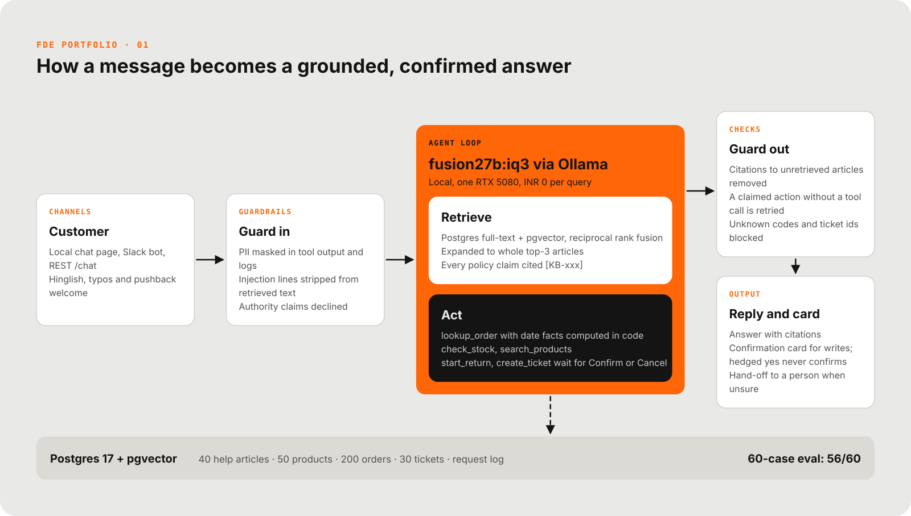

# diagram-kit

Architecture diagrams as data. Write a short YAML spec, get a branded SVG that GitHub renders natively, and a browser check that proves no text leaves its box. One look across every project; change `dk/theme.py` and every diagram follows.



## Two layouts

| Type | Use it for | Spec |
|---|---|---|
| `flow` | The overview: parts of the system left to right, the core in accent, a data band along the bottom | `examples/p1-architecture.yaml` |
| `trace` | One real request through those parts, numbered in order | `examples/p1-trace.yaml` |

## Use

```bash
python -m dk render path/to/architecture.yaml path/to/trace.yaml      # writes .svg next to each spec
python -m dk check --png path/to/architecture.svg path/to/trace.svg  # exit 1 on any layout problem
```
`render` needs PyYAML. `check` needs Playwright with a Chromium (`DK_CHROME` = path to chrome.exe to use an existing one); `--png` also saves a PNG to look at.

## Spec reference

### flow
```yaml
type: flow
kicker: FDE Portfolio · 01            # small mono line above the title (optional)
title: How a message becomes a grounded, confirmed answer
columns:                              # left to right
  - id: customer                      # a card
    tag: Channels                     # small accent label (optional)
    title: Customer
    points: [Local chat page, Hinglish welcome]   # sentences; wrapped to the column width
  - id: core                          # the accent core group (use once)
    core:
      tag: Agent loop
      title: fusion27b:iq3 via Ollama
      subtitle: Local, one GPU
      children:
        - {id: retrieve, title: Retrieve, points: [...]}             # white card
        - {id: act, title: Act, style: dark, points: [...]}          # ink card
  - stack:                            # several cards in one column, top to bottom
      - {id: guard_out, tag: Checks, title: Guard out, points: [...]}
      - {id: reply, tag: Output, title: Reply, points: [...]}
band: {title: Postgres 17, text: "what is stored", right: "headline number"}   # optional
edges:                                # arrows; direction is worked out from the positions
  - {from: customer, to: core}
  - {from: guard_out, to: reply}      # same column: a down arrow
  - {from: core, to: band, dashed: true}
note: optional footnote
```
Optional per column: `grow` (width weight; cards 1.0, core 1.7) and `style` (`light`, `dark`, `accent`, `plain`).

### trace
```yaml
type: trace
kicker: FDE Portfolio · 01
title: One return request, traced end to end
lanes:                                # 3 to 7 work best
  - {id: customer, label: Customer}
  - {id: agent, label: Agent (LLM), hot: true}     # accent lane
steps:                                # top to bottom, numbered automatically
  - {from: customer, to: agent, text: "what is sent"}
  - {from: agent, to: customer, text: "reply", tone: accent}   # tone: normal | accent | muted
  - {from: agent, to: db, text: "read", tone: muted, dashed: true}
note: optional footnote
```

## Rules the kit keeps
- Text wraps by measured width; `check` measures the real render and fails if any text leaves its box or the canvas, or two boxes overlap.
- Palette, fonts, sizes and spacing live only in `dk/theme.py`.
- Plain SVG with system fonts: no scripts, no external loads, renders in GitHub light and dark mode (the diagram is its own paper card).
